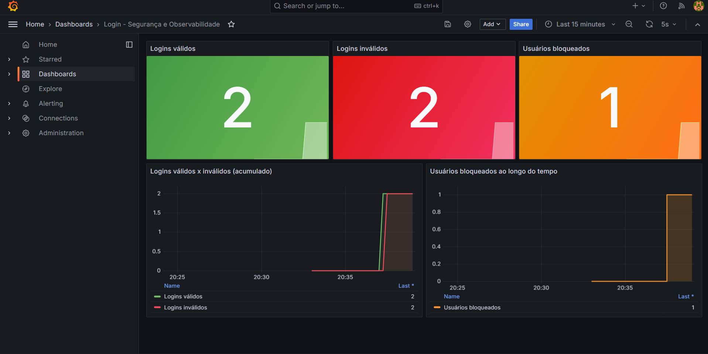

# MS-AV-02 - Segurança e Observabilidade

Sistema genérico de **login** em Spring Boot (RESTful) com:

- controle de acesso por **roles** usando `JdbcUserDetailsManager` (Spring Security);
- **bloqueio** do usuário após mais de uma falha de login (tabela `login_attempts`);
- **indicadores** (Micrometer/Actuator) de logins válidos, logins inválidos e usuários bloqueados;
- **dashboard no Grafana** (Prometheus como fonte de dados);
- documentação **OpenAPI / Swagger**.

## Dashboard do Grafana

> 📸 **Print do dashboard:** `docs/dashboard-grafana.png`
>
> 

O dashboard exportado como código está em [`grafana/dashboards/login-dashboard.json`](grafana/dashboards/login-dashboard.json).

## Tecnologias

Java 17 · Spring Boot 3.2.5 · Spring Security · Spring JDBC · H2 (em memória) · Actuator + Micrometer · Prometheus · Grafana · springdoc-openapi (Swagger UI)

## Como executar

### Opção 1 — tudo com Docker (recomendado)

Pré-requisito: Docker + Docker Compose.

```bash
docker compose up --build
```

| Serviço | URL | Credenciais |
|---|---|---|
| Aplicação (API) | http://localhost:8080 | — |
| Swagger UI | http://localhost:8080/swagger-ui.html | — |
| Métricas (Prometheus format) | http://localhost:8080/actuator/prometheus | — |
| Prometheus | http://localhost:9090 | — |
| Grafana | http://localhost:3000 | `admin` / `admin` |

O datasource do Prometheus e o dashboard **já são provisionados automaticamente** no Grafana
(dashboard: *Login - Segurança e Observabilidade*).

### Opção 2 — só a aplicação (sem Grafana)

Pré-requisitos: Java 17+ e Maven 3.8+.

```bash
mvn spring-boot:run
```

(Se quiser o Prometheus apontando para a aplicação rodando fora do Docker, troque o target em
`prometheus/prometheus.yml` para `host.docker.internal:8080`.)

## Usuários de teste (carregados em `data.sql`)

| Username | Senha | Role | Para que serve |
|---|---|---|---|
| `admin` | `admin123` | `ROLE_ADMIN` | `PUT /unlock/{userid}` |
| `manutencao` | `manut123` | `ROLE_MANUTENCAO` | `POST /` e `GET /` |
| `usuario` | `user123` | `ROLE_USER` | login comum |

## Endpoints

| Método | Path | Acesso | Descrição |
|---|---|---|---|
| POST | `/login` | **público** | Body `{"username":"","senha":""}`. Retorna **200** (válido) ou **401** (inválido/bloqueado) |
| PUT | `/trocarsenha/{userid}` | **público** | Body `{"atual":"","nova":""}`. Confere a senha atual na base e grava a nova |
| POST | `/` | `ROLE_MANUTENCAO` | Cadastra usuário. Body `{"username":"","senha":""}` (novo usuário recebe `ROLE_USER`) |
| GET | `/` | `ROLE_MANUTENCAO` | Lista todos os usuários em JSON (a senha **não** é retornada) |
| PUT | `/unlock/{userid}` | `ROLE_ADMIN` | Desbloqueia o usuário e zera as falhas |

Os endpoints protegidos usam **HTTP Basic** (stateless). Sem credenciais → **401**; credenciais válidas
mas sem a role exigida → **403**.

### Exemplos (curl)

```bash
# login válido (200) e inválido (401)
curl -i -X POST http://localhost:8080/login -H "Content-Type: application/json" \
     -d '{"username":"usuario","senha":"user123"}'

# cadastrar usuário (precisa de ROLE_MANUTENCAO)
curl -i -u manutencao:manut123 -X POST http://localhost:8080/ -H "Content-Type: application/json" \
     -d '{"username":"joao","senha":"abc123"}'

# listar usuários (precisa de ROLE_MANUTENCAO)
curl -i -u manutencao:manut123 http://localhost:8080/

# trocar senha (público)
curl -i -X PUT http://localhost:8080/trocarsenha/usuario -H "Content-Type: application/json" \
     -d '{"atual":"user123","nova":"nova1234"}'

# desbloquear usuário (precisa de ROLE_ADMIN)
curl -i -u admin:admin123 -X PUT http://localhost:8080/unlock/joao
```

> Alternativa mais simples: abra o **Swagger UI**, clique em **Authorize** (HTTP Basic) e teste tudo pelo navegador.

## Regra de bloqueio

- Cada falha de login (usuário existente + senha errada) incrementa `failed_attempts` em `login_attempts`.
- Quando as falhas ficam **maiores que 1** (ou seja, **na 2ª falha**) o usuário é bloqueado (`locked = true`).
  O limite é configurável em `application.yml` (`seguranca.login.max-falhas`).
- Usuário bloqueado recebe **401** mesmo com a senha correta e também não consegue se autenticar nos
  endpoints protegidos. Só um `ROLE_ADMIN` desbloqueia (`PUT /unlock/{userid}`).
- Um login válido zera o contador de falhas.
- Usuários inexistentes **não** geram registro em `login_attempts` (evita poluir a tabela e inflar o indicador de bloqueados).
- Como `PUT /trocarsenha` é público, informar a **senha atual errada** também conta como falha
  (senão o endpoint seria uma brecha para tentar senhas sem limite).

## Indicadores (Micrometer → Prometheus)

| Métrica Prometheus | Tipo | Significado |
|---|---|---|
| `logins_validos_total` | counter | Quantidade de logins válidos |
| `logins_invalidos_total` | counter | Quantidade de logins inválidos (usuário inexistente, senha errada ou usuário bloqueado) |
| `usuarios_bloqueados` | gauge | Total de usuários bloqueados **no momento** (lido de `login_attempts`) |

Os contadores ficam em memória e zeram quando a aplicação reinicia (o banco H2 também é em memória).

## Gerando dados para o dashboard

Com os containers no ar, rode o script que dispara logins válidos, inválidos, bloqueios e um desbloqueio:

```bash
chmod +x scripts/gerar-trafego.sh
./scripts/gerar-trafego.sh        # Linux / macOS / Git Bash (Windows)
```

Aguarde ~10 segundos e abra http://localhost:3000 → *Dashboards* → **Login - Segurança e Observabilidade**.

## Entrega — checklist

- [ ] Repositório **público** no GitHub com todo o projeto
- [ ] Print do dashboard em `docs/dashboard-grafana.png`
- [ ] Dashboard exportado (JSON) no repositório — `grafana/dashboards/login-dashboard.json`
- [ ] Link do repositório enviado

### Como tirar o print e (opcionalmente) re-exportar o dashboard

1. `docker compose up --build` e depois `./scripts/gerar-trafego.sh`.
2. Em http://localhost:3000 abra o dashboard e tire o print (ajuste o período para *Last 15 minutes*). Salve em `docs/dashboard-grafana.png`.
3. Para exportar pela interface do Grafana (conforme o enunciado): **Export → Export as JSON → Save to file**
   e salve o arquivo em `grafana/dashboard-exportado.json` (opcional — o JSON provisionado já está no formato de exportação).

## Decisões e observações sobre o enunciado

1. **Erro de sintaxe no SQL do enunciado:** o `CREATE TABLE login_attempts` tinha uma vírgula sobrando depois de
   `updated_at ... DEFAULT CURRENT_TIMESTAMP,`, o que impede a criação da tabela. Foi corrigido em `schema.sql`.
2. **Senhas em texto puro:** a coluna `usuarios.senha` é `VARCHAR(10)` (definida no enunciado), tamanho que não comporta
   um hash BCrypt (60 caracteres). Por isso a comparação é feita em texto puro (`NoOpPasswordEncoder`) e as senhas
   são limitadas a 10 caracteres. **Em produção** o correto é BCrypt e uma coluna maior.
3. **`JdbcUserDetailsManager` + tabela `usuarios`:** o `JdbcUserDetailsManager` foi configurado com queries próprias para
   ler credenciais de `usuarios` e o status de bloqueio de `login_attempts` (usuário bloqueado ⇒ `enabled = false`).
   As roles ficam na tabela `authorities` (padrão do Spring). O cadastro (`POST /`) usa `createUser(...)` do manager.
4. **Banco H2 em memória:** os dados são recriados a cada inicialização a partir de `schema.sql` e `data.sql`.

## Estrutura

```
.
├── pom.xml
├── Dockerfile
├── docker-compose.yml
├── prometheus/prometheus.yml
├── grafana/
│   ├── provisioning/        (datasource + provider do dashboard)
│   └── dashboards/login-dashboard.json
├── scripts/gerar-trafego.sh
├── docs/                    (coloque aqui o print: dashboard-grafana.png)
└── src/main/
    ├── java/com/espm/seguranca/
    │   ├── config/          SecurityConfig, OpenApiConfig
    │   ├── controller/      AuthController, UsuarioController
    │   ├── dto/
    │   ├── exception/
    │   ├── metrics/         LoginMetricas
    │   ├── repository/      UsuarioRepository, LoginAttemptRepository
    │   ├── security/        UsuariosUserDetailsManager, SenhaUtil
    │   └── service/         LoginService, UsuarioService
    └── resources/           application.yml, schema.sql, data.sql
```
